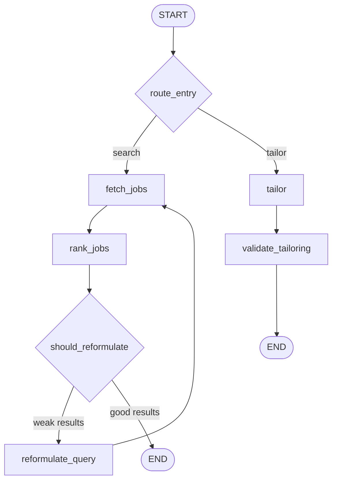

# Job Searching Agent

A LangGraph agent that finds and ranks job listings for a candidate profile, refines its search when results are weak, and tailors application material for a chosen job.

> **Status:** Draft based on the graph wiring (`build_graph`) only. Sections marked **TODO** need details from the node functions, state definition, and prompts.

---

## Overview

The agent has two modes, selected at entry by `route_entry`:

1. **Search mode:** fetch jobs, rank them, and reformulate the query if results are poor.
2. **Tailor mode:** tailor application material (e.g. resume) for a selected job, then validate the result.

---

## Graph



---

## Nodes

| Node | Purpose | Notes |
|---|---|---|
| `route_entry` | Conditional entry. Chooses `fetch_jobs` or `tailor`. | **TODO:** document the routing condition. |
| `fetch_jobs` | Retrieves job listings for the current query/profile. | **TODO:** list job sources/APIs. |
| `rank_jobs` | Scores and orders listings against the profile. | **TODO:** ranking criteria (LLM, embeddings, rules). |
| `should_reformulate` | Conditional edge after ranking. Loops to `reformulate_query` or ends. | **TODO:** threshold and max-attempt logic. |
| `reformulate_query` | Rewrites the search query, then returns to `fetch_jobs`. | **TODO:** prompt and strategy. |
| `tailor` | Tailors application material for a selected job. | **TODO:** inputs and outputs. |
| `validate_tailoring` | Checks the tailored output, then ends. | Currently does not gate or retry. |

---

## State (`AgentState`)

**TODO:** document the fields. Suggested table:

| Field | Type | Description |
|---|---|---|
| `profile` | | Candidate profile input |
| `query` | | Current search query |
| `jobs` | | Fetched listings |
| `ranked_jobs` | | Ranked listings |
| `attempts` | | Reformulation counter |
| `selected_job` | | Job chosen for tailoring |
| `tailored_output` | | Result of `tailor` |
| `validation` | | Result of `validate_tailoring` |

---

## Persistence

The graph compiles with a checkpointer (`MemorySaver` by default, via `_checkpointer()`).

- `MemorySaver` is in-memory only. State is lost when the process restarts.
- For resuming across sessions, use `SqliteSaver` or `PostgresSaver`.
- Always pass a `thread_id` in the run config:

```python
config = {"configurable": {"thread_id": "user-123"}}
graph.invoke(initial_state, config)
```

---

## Observability (Langfuse)

Runs are traced with [Langfuse](https://langfuse.com). Each graph run appears as one trace, with a span per node (`fetch_jobs`, `rank_jobs`, `reformulate_query`, `tailor`, `validate_tailoring`) and nested LLM calls inside them.

**Setup**

```bash
LANGFUSE_PUBLIC_KEY=pk-lf-...
LANGFUSE_SECRET_KEY=sk-lf-...
LANGFUSE_HOST=https://cloud.langfuse.com   # or your self-hosted URL
```

**Attaching the handler** (import path depends on your SDK version; v3 shown):

```python
from langfuse.langchain import CallbackHandler

langfuse_handler = CallbackHandler()

result = graph.invoke(
    {"profile": profile},
    config={
        "configurable": {"thread_id": "user-123"},
        "callbacks": [langfuse_handler],
        "metadata": {
            "langfuse_session_id": "user-123",   # groups runs per session
            "langfuse_user_id": "user-123",
            "langfuse_tags": ["job-agent"],
        },
    },
)
```

**What to watch in Langfuse**

- **Reformulation loop:** count of `reformulate_query` spans per trace. A high count means weak queries or a poor ranking threshold.
- **Latency and cost per node:** `fetch_jobs` and `rank_jobs` are the likely hotspots.
- **Tailoring quality:** log the `validate_tailoring` result as a score (`langfuse.score_current_trace(name="tailoring_valid", value=...)`) so failures can be filtered and tracked over time.
- **Prompts:** consider moving the ranking, reformulation, and tailoring prompts into Langfuse Prompt Management to version them and link them to traces.

**TODO:** confirm the SDK version, where the handler is created, and whether scores or prompt management are already in use.

---

## Usage

```python
from agent import build_graph

graph = build_graph()
result = graph.invoke(
    {"profile": profile},  # TODO: confirm required input keys
    config={"configurable": {"thread_id": "user-123"}, "recursion_limit": 25},
)
```

---

## Known Issues and Recommendations

1. **Unbounded search loop.** The `fetch_jobs` → `rank_jobs` → `reformulate_query` cycle needs a max-attempts counter in `AgentState`, checked in `should_reformulate`. Set `recursion_limit` as a backstop.
2. **Validation does not gate.** `validate_tailoring` always goes to END. Add a conditional edge back to `tailor` on failure, with a retry cap.
3. **Volatile checkpointer.** Switch from `MemorySaver` to a persistent saver if sessions must survive restarts.
4. **Docstring mismatch.** `build_graph` says it starts from the profile input, but `route_entry` can start at `tailor`.

---

## Configuration

| Variable | Purpose |
|---|---|
| `LANGFUSE_PUBLIC_KEY` | Langfuse project public key |
| `LANGFUSE_SECRET_KEY` | Langfuse project secret key |
| `LANGFUSE_HOST` | Langfuse cloud or self-hosted URL |

**TODO:** LLM API keys, model names, and job-source settings.

## Testing

**TODO:** how to run tests and sample inputs.