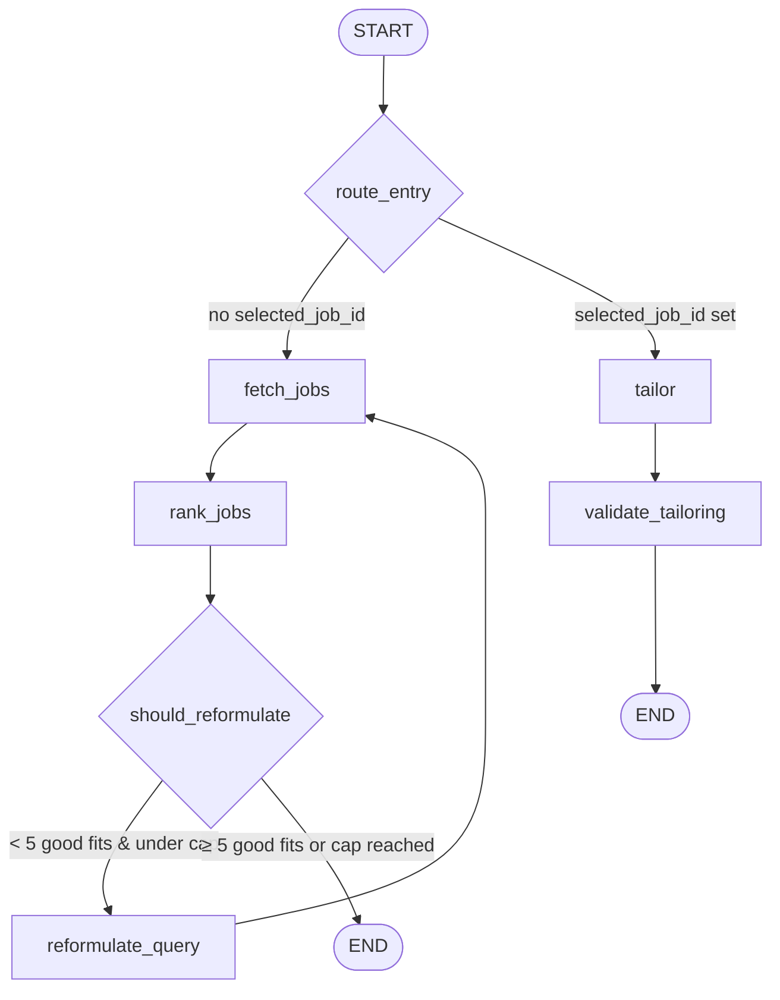

# Job Searching Agent

An AI-powered LangGraph agent that finds, ranks, and tailors job applications for a candidate. Upload a CV, and the agent extracts a structured profile, searches multiple job boards, scores each listing against your skills, and — when you pick a job — generates a tailored CV and cover letter grounded entirely in your real experience.

---

## Overview

The agent operates in two phases, routed automatically at entry:

1. **Search phase** — extract a candidate profile from a CV, fetch jobs from multiple sources, rank them by fit, and optionally reformulate the query if results are thin.
2. **Tailor phase** — given a selected job from the search results, produce a tailored CV and cover letter, then run a deterministic fabrication validator to flag any claims that can't be traced back to the candidate's actual experience.

---

## Architecture

```
src/job_agent/
├── config.py              # Pydantic settings from .env
├── corpus.py              # CV text → verifiable corpus items
├── llm.py                 # LLM factory with provider fallbacks
├── profile.py             # CV text → structured Profile (LLM)
├── runner.py              # Orchestrator (stream_search / stream_tailor)
├── tracing.py             # Langfuse tracing & callbacks
├── validation.py          # Deterministic fabrication checker
├── graph/
│   ├── graph.py           # LangGraph state machine definition
│   ├── state.py           # AgentState TypedDict
│   ├── schemas.py         # Pydantic models (Profile, JobPosting, …)
│   ├── nodes/
│   │   ├── fetch_jobs.py          # Search job boards via LLM tool call
│   │   ├── rank_jobs.py           # Batch-score jobs against the profile
│   │   ├── reformulate_query.py   # Broaden the search query
│   │   ├── tailor.py              # Generate tailored CV + cover letter
│   │   └── validate_tailoring.py  # Run the fabrication validator
│   └── prompts/
│       ├── rank_jobs.py       # Ranking prompt
│       ├── reformulate.py     # Query broadening prompt
│       └── tailor.py          # Tailoring prompt (strict grounding rules)
└── tools/
    ├── cv_readers.py      # PDF → plain text (pypdf)
    ├── jobs_api.py        # JSearch, Adzuna, Remotive adapters
    └── research.py        # Tavily company research (optional)
```

---

## Graph



---

## Nodes

### `route_entry`

Conditional edge from `START`. Routes to `fetch_jobs` when no `selected_job_id` is in state, or to `tailor` when one is provided (second invocation on the same thread).

### `fetch_jobs`

1. Builds a prompt describing the candidate profile (seniority, roles, skills, locations, remote preference).
2. Binds the `search_jobs` tool and asks the LLM to generate a concise job-title query (2–6 words).
3. Calls `run_search`, which fans out to available sources in priority order: **JSearch → Adzuna** (Remotive currently disabled).
4. Merges new results with prior ones (on reformulation loops), dedupes by `(title, company)`, and caps at 25.

### `rank_jobs`

1. Splits unscored jobs into batches (default batch size: 4, configurable via `SCOUT_RANK_BATCH`).
2. Sends each batch to the LLM with a structured-output prompt, producing a `fit_score` (0–100), `fit_explanation`, `matched_skills`, and `gaps` per job.
3. Batches run concurrently (up to 4 threads) for latency; previously scored jobs are skipped on reformulation loops.
4. Returns all jobs sorted by `fit_score` descending.

### `should_reformulate`

Conditional edge after `rank_jobs`. Loops back to `reformulate_query` when:
- Fewer than **5** jobs scored ≥ **60** (`GOOD_FIT_THRESHOLD`)
- AND the reformulation counter is below the cap (default **2**, overridable via `SCOUT_MAX_REFORMULATIONS`; set to 0 for single-pass mode).

Otherwise, exits to `END`.

### `reformulate_query`

Asks the LLM to produce a broader or alternative search query (synonyms, adjacent titles, less specificity), then increments `reformulation_count` and loops back to `fetch_jobs`.

### `tailor`

1. Resolves the `selected_job_id` from checkpointed `ranked_jobs`.
2. Builds a `CandidateCorpus` from the CV text — every bullet, skill, education line, and summary sentence gets a unique id.
3. Optionally calls **Tavily** to research the target company (one search, ≤ 3 results).
4. Invokes the LLM with `TailoringPack` structured output. The prompt enforces strict grounding: the LLM may only **select, reorder, emphasize, trim, and reword** corpus items — never invent facts.
5. Outputs: tailored CV (headline, summary, experience with `corpus_ref` per bullet, skills, education), a ≤ 350-word cover letter, and an honesty note naming real gaps.

### `validate_tailoring`

Runs the **deterministic fabrication validator** (`validation.py`) — zero LLM calls, same result every time:

| Check | Threshold | Method |
|---|---|---|
| **CV bullets** | `SCOUT_FAB_BULLET_RATIO` (0.65) | Each rewritten bullet must reach this `difflib.SequenceMatcher` ratio against its referenced corpus item. Numbers and units are canonicalized (10M ↔ 10 million, /day ↔ daily). |
| **Skills** | `SCOUT_FAB_SKILL_RATIO` (0.85) | Each skill must match a corpus skill item (or be a word-subset of one). Falls back to full-text grounding when no skills section was parsed. |
| **Cover letter** | `SCOUT_FAB_LETTER_RATIO` (0.55) | Only "factual-looking" sentences (containing digits, years, or capitalized multi-word names) are checked. Each must trace to the corpus, research notes, or job context. A miss gets a second chance against two-reference combinations. |

Flags are written to `fabrication_flags` and `fabrication_report` in state for the UI and trace.

---

## State (`AgentState`)

| Field | Type | Description |
|---|---|---|
| `cv_text` | `str` | Raw text extracted from the uploaded CV PDF |
| `profile` | `Profile \| None` | Structured candidate profile (name, seniority, roles, skills, experience, locations, languages, remote preference) |
| `search_query` | `str \| None` | Current job search query (set by `fetch_jobs`, updated by `reformulate_query`) |
| `jobs` | `list[JobPosting]` | All fetched job listings (merged across reformulation loops) |
| `ranked_jobs` | `list[RankedJob]` | Jobs scored against the profile, sorted by `fit_score` descending |
| `reformulation_count` | `int` | Number of query reformulations so far |
| `llm_calls` | `int` | Cumulative LLM calls across all nodes (used for budget enforcement) |
| `errors` | `list[str]` | Non-fatal warnings and errors collected during the run |
| `jobs_sources` | `list[str]` | Which job sources contributed results (e.g. `["jsearch", "adzuna"]`) |
| `selected_job_id` | `str \| None` | Job id chosen for tailoring (triggers the tailor phase) |
| `tailoring` | `TailoringPack \| None` | Generated tailored CV + cover letter + honesty note |
| `linkedin_zip_path` | `str \| None` | Path to LinkedIn data export (reserved, not yet used) |
| `research_notes` | `str \| None` | Company research from Tavily (if available) |
| `fabrication_flags` | `int` | Number of claims the validator could not ground |
| `fabrication_report` | `FabricationReport \| None` | Full validator output with per-claim details |

---

## Data Models

### `Profile`

Extracted from CV text by an LLM: `name`, `seniority` (junior / mid / senior / lead / unknown), `primary_roles`, `skills`, `years_experience`, `locations`, `languages`, `remote_ok`, `raw_summary`.

### `JobPosting`

Normalized across all sources: `job_id`, `title`, `company`, `location`, `remote`, `description`, `url`, `tags`, `source` (jsearch / adzuna / remotive / cache).

### `RankedJob`

A `JobPosting` plus `fit_score` (0–100), `fit_explanation`, `matched_skills`, and `gaps`.

### `TailoringPack`

- `cv`: `CVContent` — `headline`, `summary`, `experience` (list of `ExperienceEntry` with `TailoredBullet` items referencing corpus ids), `skills`, `education`.
- `cover_letter`: ≤ 350 words, references ≥ 2 job requirements.
- `honesty_note`: names real gaps.

### `FabricationReport`

`flags` count, `claims_checked`, per-claim `FlaggedClaim` details (`where`, `text`, `reason`, `best_match_ratio`), and the `thresholds` the report ran with.

---

## Job Sources

| Source | Type | Key Required | Notes |
|---|---|---|---|
| **JSearch** | Google-for-Jobs aggregator (RapidAPI) | `JSEARCH_API_KEY` | Best city-level location matching. Free tier ~200 req/month. Highest priority. |
| **Adzuna** | Official jobs API (~20 countries) | `ADZUNA_APP_ID` + `ADZUNA_APP_KEY` | Free registration. Falls in when JSearch returns < 5 results. |
| **Remotive** | Remote-only jobs (keyless) | None | Currently disabled in code; can be re-enabled. |

Sources are queried concurrently when `SCOUT_CONCURRENT_SOURCES=true` (default). A soft deadline (`SCOUT_SOURCE_SOFT_DEADLINE`, default 5s) gives the highest-priority source time before falling through to faster ones.

---

## Candidate Corpus

The `corpus.py` module segments raw CV text into individually addressable items:

- **Bullets** — experience lines (the default for unrecognized sections)
- **Skills** — comma-separated items under skills/technologies headings
- **Education** — lines under education headings
- **Summary** — leading paragraphs or lines under summary/profile headings

Each item gets an id like `cv-bullet-001`, `cv-skill-003`. The tailor LLM selects from these ids, and the validator checks rewrites against them. Contact information (emails, phone numbers, LinkedIn URLs) is filtered out.

---

## LLM Configuration

Models are specified as `provider:model` strings (e.g. `openai:gpt-4o-mini`, `groq:openai/gpt-oss-120b`). The factory in `llm.py` uses LangChain's `init_chat_model` and automatically attaches a fallback model if one is configured and differs from the primary.

| Setting | Default | Used By |
|---|---|---|
| `SCOUT_MODEL` | `openai:gpt-4o-mini` | Ranking, reformulation |
| `SCOUT_TAILOR_MODEL` | `openai:gpt-4o-mini` | Tailoring |
| `SCOUT_FETCH_MODEL` | (falls back to `SCOUT_MODEL`) | Fetch-jobs tool-call |
| `FALLBACK_MODEL` | `groq:openai/gpt-oss-120b` | Auto-fallback on failure |

A per-run LLM call budget (`MAX_LLM_CALLS_PER_RUN`, default 25) is enforced before every LLM invocation. Exceeding it raises `LLMBudgetExceededError`.

---

## Persistence

The graph compiles with a **`MemorySaver`** checkpointer (in-memory). State is preserved across the search → tailor invocations within the same process, keyed by `thread_id`.

- State is **lost** when the process restarts.
- For persistent sessions, swap in `SqliteSaver` or `PostgresSaver`.
- Always pass a `thread_id`:

```python
config = {"configurable": {"thread_id": "user-123"}}
```

---

## Observability (Langfuse)

Every graph run is traced with [Langfuse](https://langfuse.com). Each node gets its own span, with nested LLM calls inside. The CV PDF is attached to the trace as a media artifact.

**What to watch:**

- **Reformulation loops** — count of `reformulate_query` spans per trace. High counts signal weak queries or a poor ranking threshold.
- **Latency and cost per node** — `fetch_jobs` (network-bound) and `rank_jobs` (LLM-bound) are the hotspots.
- **Fabrication rate** — `fabrication_report.flags / fabrication_report.claims_checked` from the `validate_tailoring` span.
- **Source health** — `run_search` span metadata shows which sources were used and why others failed (HTTP 429, timeout, key rejected).

---

## Configuration

All settings are read from `.env` (or environment variables) via Pydantic Settings.

### API Keys

| Variable | Required | Purpose |
|---|---|---|
| `OPENAI_API_KEY` | Yes (if using OpenAI models) | OpenAI LLM access |
| `GROQ_API_KEY` | No | Groq fallback LLM access |
| `JSEARCH_API_KEY` | No | JSearch job aggregator (RapidAPI) |
| `ADZUNA_APP_ID` | No | Adzuna jobs API credentials |
| `ADZUNA_APP_KEY` | No | Adzuna jobs API credentials |
| `TAVILY_API_KEY` | No | Company research for cover letters |

### Observability

| Variable | Default | Purpose |
|---|---|---|
| `LANGFUSE_PUBLIC_KEY` | — | Langfuse project public key |
| `LANGFUSE_SECRET_KEY` | — | Langfuse project secret key |
| `LANGFUSE_BASE_URL` | `https://us.cloud.langfuse.com` | Langfuse host URL |

### Agent Tuning

| Variable | Default | Purpose |
|---|---|---|
| `SCOUT_MODEL` | `openai:gpt-4o-mini` | Primary model for ranking / reformulation |
| `SCOUT_TAILOR_MODEL` | `openai:gpt-4o-mini` | Model for tailoring (temperature 0.3) |
| `SCOUT_FETCH_MODEL` | (same as `SCOUT_MODEL`) | Model for the fetch-jobs tool call |
| `FALLBACK_MODEL` | `groq:openai/gpt-oss-120b` | Auto-fallback on primary failure |
| `MAX_LLM_CALLS_PER_RUN` | `25` | Per-run LLM call budget |
| `SCOUT_MAX_JOBS` | `10` | Max jobs to fetch per source per search |
| `SCOUT_MAX_REFORMULATIONS` | `2` | Max query reformulation loops (0 = single pass) |
| `SCOUT_RANK_BATCH` | `4` | Jobs per ranking batch (latency vs. cost knob) |
| `SCOUT_CONCURRENT_SOURCES` | `true` | Run job sources in parallel |
| `SCOUT_SOURCE_SOFT_DEADLINE` | `5.0` | Seconds to wait for the first concurrent source |

### Fabrication Thresholds

| Variable | Default | Purpose |
|---|---|---|
| `SCOUT_FAB_BULLET_RATIO` | `0.65` | Min similarity for a rewritten CV bullet vs. its corpus source |
| `SCOUT_FAB_SKILL_RATIO` | `0.85` | Min similarity for a skill vs. the corpus skill vocabulary |
| `SCOUT_FAB_LETTER_RATIO` | `0.55` | Min similarity for a factual cover-letter sentence vs. references |

---

## Usage

### Programmatic (batch)

```python
from job_agent.tools.cv_readers import extract_cv_text
from job_agent.runner import run_once, stream_tailor

# Phase 1: extract profile + search + rank
cv_text = extract_cv_text("path/to/resume.pdf")
result = run_once(cv_text, cv_path="path/to/resume.pdf", thread_id="user-123", tags=["batch"])

for job in result.ranked_jobs[:5]:
    print(f"{job.fit_score:3d}  {job.job.title} @ {job.job.company}")

# Phase 2: tailor for a selected job
for kind, payload in stream_tailor(thread_id="user-123", selected_job_id=result.ranked_jobs[0].job.job_id, tags=["batch"]):
    if kind == "result":
        print(payload.pack.cover_letter)
```

### Streaming (UI integration)

```python
from job_agent.profile import extract_profile
from job_agent.runner import stream_search

profile = extract_profile(cv_text, thread_id="user-123")

for kind, payload in stream_search(profile, cv_text=cv_text, thread_id="user-123", tags=["ui"]):
    if kind == "status":
        print(f"⏳ {payload}")
    elif kind == "result":
        print(f"✅ Found {payload.n_jobs_ranked} jobs in {payload.latency_s}s (${payload.cost_usd:.4f})")
```

---

## Setup

### Prerequisites

- Python ≥ 3.12
- [uv](https://docs.astral.sh/uv/) (recommended) or pip

### Install

```bash
# Clone the repo
git clone <repo-url> && cd Job-Agent

# Install with uv
uv sync

# Or with pip
pip install -e .
```

### Configure

```bash
cp .env.example .env
# Fill in your API keys
```

### Run

```bash
# Via the installed script entry point
job-agent

# Or directly
uv run python -c "from job_agent.runner import run_once; ..."
```

---

## Dependencies

| Package | Purpose |
|---|---|
| `langchain` / `langchain-core` | LLM orchestration, tool binding, structured output |
| `langchain-groq` | Groq provider for fallback models |
| `langchain-openai` | OpenAI provider |
| `langgraph` | State machine graph with checkpointing |
| `langfuse` | LLM observability and tracing |
| `pydantic` / `pydantic-settings` | Data validation, settings management |
| `pypdf` | CV PDF text extraction |
| `httpx` | HTTP client for job APIs and Tavily |
| `grandalf` | Graph layout (for visualization) |
| `openai` | OpenAI SDK |

---

## License

Not yet specified.